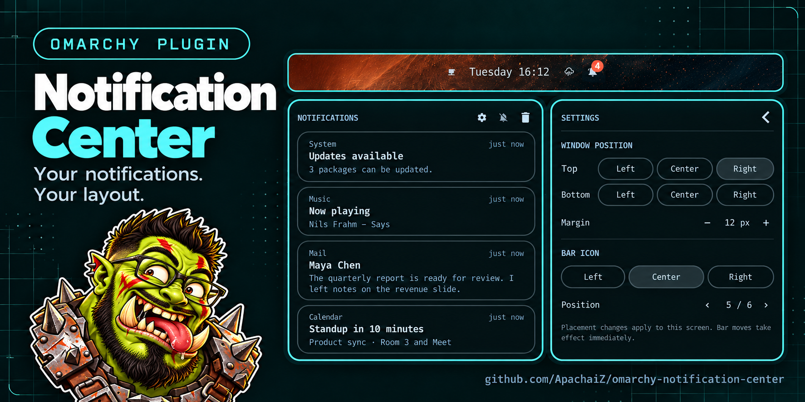
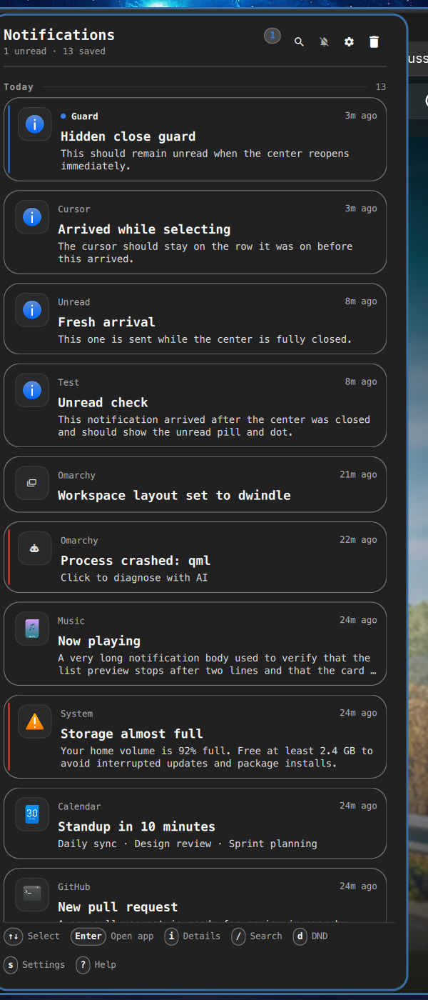
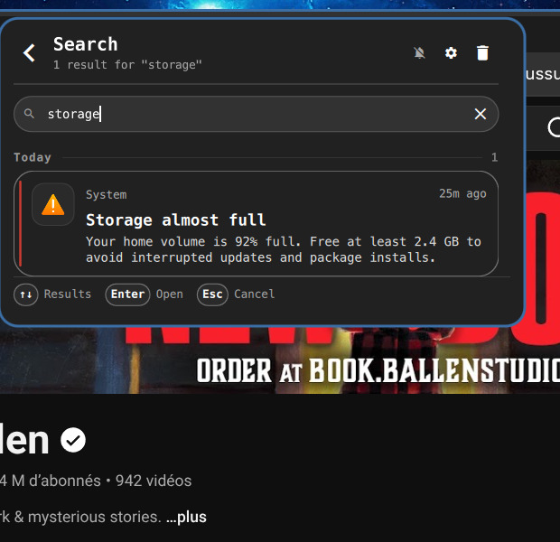
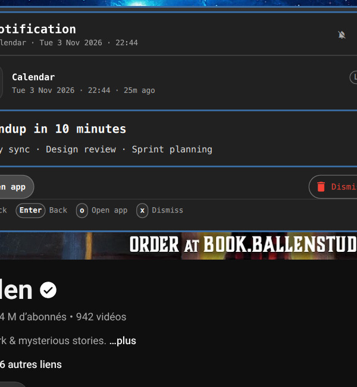
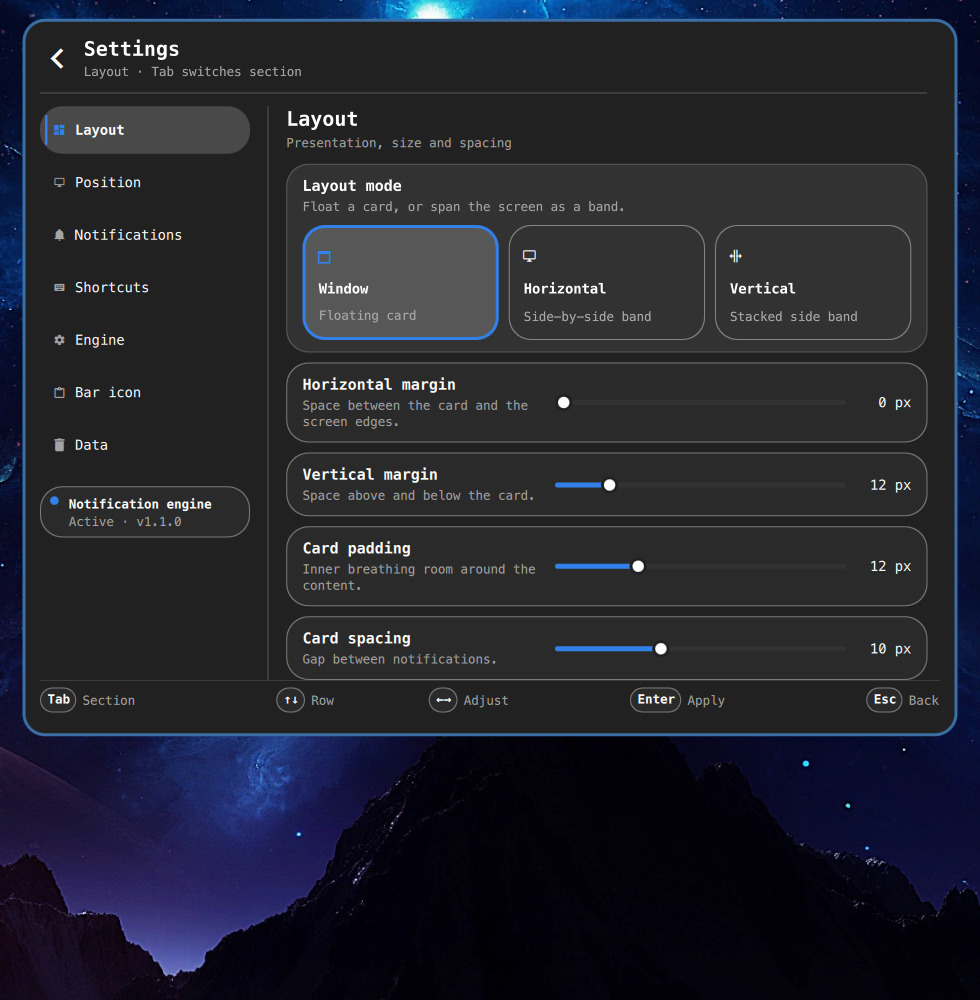
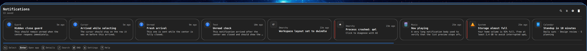
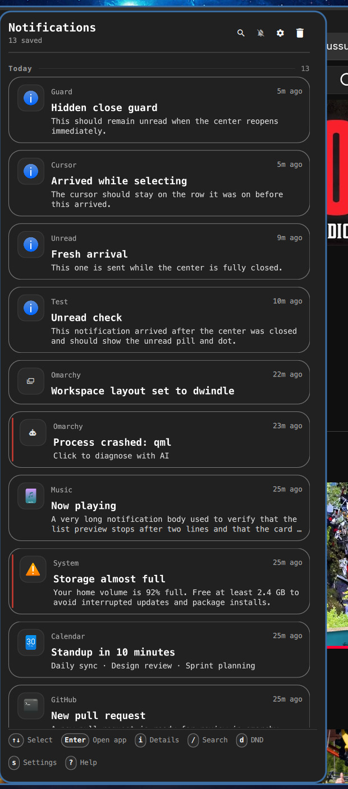
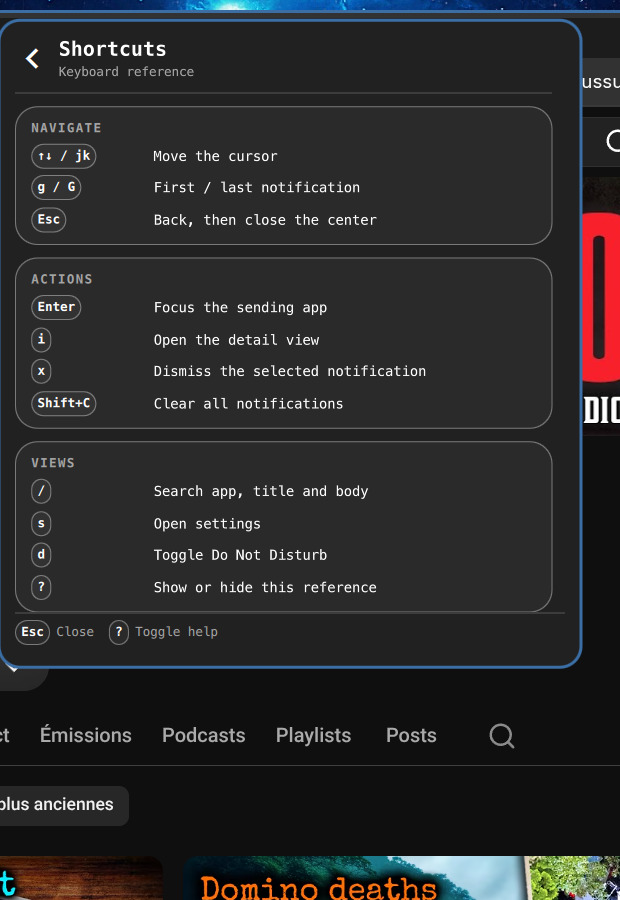

# Omarchy Notification Center



A notification center for [Omarchy](https://omarchy.org) Quattro. It is a bar
widget and a keyboard-first inbox: a virtualized card list, a focused detail
view, search, dismiss one or all, an unread badge, Do Not Disturb, and a
sectioned settings view with a navigation rail. Cards, the detail view and the
settings panel share one theme-aware visual language.

The center does **not** own the notification server. It reads the history of
the stock `omarchy.notifications` service, or of the optional
[Notification Engine](https://github.com/ApachaiZ/omarchy-notification-engine)
when you install it and want this project to display and manage notifications
itself.



All captures use synthetic notification content.

## Features

- **Virtualized list** — only the rows inside the viewport are instantiated,
  so a full 1000-entry archive starts as fast as a handful of notifications.
  Search spans the whole archive.
- **History** — reads the active service's history. With the stock
  `omarchy.notifications` service it shows whatever that service retains; with
  the optional **Notification Engine** it keeps 30 days (up to 1000 entries).
  **Capture history** can be switched Off with the engine to stop new history;
  live toasts still display and remain actionable.
- **Search** — `/` (or `Ctrl+F`) and the header icon filter app names, titles,
  and bodies.
- **Date groups** — the list separates Today, Yesterday, weekdays, and older
  dates.
- **Archived images** — with the engine, notification images are copied once
  into the private archive, pruned with the history, and purged when previews
  are disabled. With the stock service, its own image copies are read.
- **Card list** — rounded icon plate, app name, relative time, title, and a
  two-line body preview. Unread rows carry a dot and an accent rail; critical
  rows keep the urgent rail. The keyboard cursor gets the accent border and a
  raised fill.
- **Detail view** — app/urgency header, full summary, full body, the attached
  image when the notification carries one, and explicit **Open app** /
  **Dismiss** actions. Decoded images are bounded to the card size.
- **Dismiss one or all** — click a card to open its detail view; hover it for
  **Open app** and **Remove** buttons; right-click it to remove. The header's
  clear button asks for confirmation when that setting is on. With the engine,
  a single removal addresses the exact notification stem, never a summary
  substring.
- **Unread badge** — the bar badge counts notifications received since the
  center was last opened, and the header shows the same count as a pill. The
  shared store means every monitor's bell agrees.
- **Do Not Disturb** — right-click the bell or use the header button; silenced
  notifications still land in the list.
- **Three layouts** — floating window, horizontal band, or vertical band.
  Each side margin, the padding, and the gap between cards are configurable;
  the layout is chosen with three visual tiles.
- **Open the sender** — `Enter` (default) opens the sending app; `i` or a card
  click opens the detail view, which also has an **Open app** button. `Enter`
  can be switched to open details instead. In the detail view, `o` opens the
  app.
- **Help and hints** — `g`/`G` jump to the first/last notification, `?` shows
  the grouped shortcut reference, and the footer uses keycaps for the active
  commands. The hint bar can be hidden.
- **Privacy** — hide notification bodies, disable and purge image previews, or
  hide the unread badge. The center and engine drop remote image URLs; with the
  stock service, its own toasts keep the stock service's behavior. Every text
  element is rendered as plain text, except notification bodies, which use
  styled text only after `` tags have been stripped. With no engine, the
  pre-3.0 private archive is removed unless a retained row still points at one
  of its image copies; in that case the center prunes every unreferenced copy
  and removes the whole tree once the last reference disappears, so an
  installed-but-disabled engine cannot keep old data alive. An enabled engine
  at least 1.0.5 migrates the archive and cleans expired images itself; an
  enabled older engine is updated once per session, and the legacy tree stays
  untouched until the updated engine takes over, so retained history never
  loses the image copies or the archive it still has to merge.
- **Keyboard control** — arrows or `h`/`j`/`k`/`l`, `Enter`, `Del`/`x`, `/`
  search, `d` Do Not Disturb, `Shift+C` clear, `g`/`G`, `?`, `Esc`, and
  the Settings key (default `s`). The search, DND, details, settings, and
  help keys are configurable in Settings.
- **Keyboard-driven settings** — Tab switches category, arrows or `hjkl` move
  between rows, left/right adjusts the focused value, `Enter` applies.
- **Placement settings** — choose the window position (top/bottom ×
  left/center/right) with a fine edge margin, and move the bar icon between the
  left, center, and right sections with an exact index.
- **Chosen monitors** — pin the center and its toasts to one or several of the
  detected outputs (up to four). The choice is explicit and independent of the
  focused monitor; selecting both shows both windows on both screens.
- **Matching toasts (engine)** — when the notification engine is installed,
  toasts use the center's position; a centered vertical placement is clamped
  to the top so a toast never sits in the middle of the screen. With the stock
  service, toasts use the stock service's own placement.
- **Theme-aware** — colors, radius, and fonts come from the active Omarchy
  theme.

| List | Search |
| --- | --- |
|  |  |

| Detail | Settings |
| --- | --- |
|  |  |

| Horizontal band | Vertical band |
| --- | --- |
|  |  |

| Shortcut help | |
| --- | --- |
|  | |

| Bar bell | Silence |
| --- | --- |
|  |  |

## Notification engine (optional)

The center works **without** an engine: enable the stock
`omarchy.notifications` service and the center reads its live toasts and
history. To let this project display and manage notifications itself, install
the optional [Notification Engine](https://github.com/ApachaiZ/omarchy-notification-engine):

```bash
omarchy plugin add https://github.com/ApachaiZ/omarchy-notification-engine --enable --yes
```

**Warning:** the engine replaces `omarchy.notifications` for notification
display and management. Only one process can own the notification bus; the
shell's clone guard disables `omarchy.notifications` when the engine is
enabled. The center stays installed, but the stock service stops handling
notifications.

You can also install it from **Settings → Engine → Install**. To return to
the stock service:

```bash
omarchy plugin remove apach.notification-engine
omarchy plugin enable omarchy.notifications
```

The center continues to work either way.

**Capture history** only applies when the engine is active:

- **On (default)** — received toasts are displayed and kept in the engine's
  30-day history.
- **Off** — live toasts still display and remain actionable, but nothing new
  is added to history. Existing history is untouched.
- With the stock service, the setting is ignored; the stock service always
  keeps its own history.

The engine is a separate plugin and repository. The center and the engine are
two separate plugins; each needs its own marketplace listing if published.

## Settings

The gear button or the configured Settings key (`s` by default; `Shift+P` is
selectable) opens the settings view. It is a navigation rail plus one focused
category pane, so the old long scroll of tiny segmented controls is gone:

- **Layout** — three visual layout tiles (`Window`, `Horizontal`, `Vertical`),
  then sliders for the horizontal and vertical margins (0–64 px in 4 px steps),
  inner padding (4–32 px), and card spacing (2–24 px). The bar's own thickness
  is added on its side.
- **Position** — a miniature screen grid for the six corners/edges, a
  **Center screen** action, and monitor chips. A vertical band hangs from the
  top, so its Bottom row and the center action are disabled. Up to four
  detected outputs can host the center and its toasts.
- **Notifications** — what `Enter` opens, the hint bar, and privacy switches:
  hide bodies, image previews, unread badge, and engine history capture.
- **Shortcuts** — Search (`/` or `Ctrl+F`), DND (`d`/`Shift+D`), Details
  (`i`/`Shift+I`), Help (`?`/`F1`), and Settings (`s`/`Shift+P`).
- **Engine** — live engine status and version, one **Install / Enable /
  Update** action, **Run notification actions**, **Allow DND bypass**, and a
  short security note. App names are chosen by senders, so these switches are
  the reliable way to refuse spoofed actions or a spoofed DND bypass.
- **Bar icon** — `Left`, `Center`, or `Right` section plus an exact position
  stepper inside that section. Moves go through `omarchy bar move`.
- **Data** — clear confirmation, saved-notification count and retention, and
  the destructive **Clear all notifications** action with the same two-step
  confirmation.

Navigation is shared by mouse and keyboard: **Tab / Shift+Tab** changes
section, **↑↓ / jk** moves rows, **←→ / hl** adjusts the focused value, and
**Enter** applies it. The selected row and sidebar category stay in sync when
the mouse enters a control.

Settings are stored in `~/.local/state/omarchy/notifications-center.json`
alongside the last-seen timestamp.

## Keyboard

| Key | Action |
| --- | --- |
| `/` or `Ctrl+F` | Search app, title, or body |
| `↑` / `↓` or `k` / `j` | Move the cursor / scroll |
| `Enter` or `Space` | Open the sender app (configurable) / go back |
| `i` | Open the detail view for the selection |
| `o` (detail) | Open the sender app |
| `g` / `G` | First / last notification |
| `Del` or `x` | Remove the selected notification |
| `d` | Toggle Do Not Disturb |
| `Shift+C` | Clear all (press twice unless confirmation is off) |
| `?` | Show shortcut help |
| `s` or `Shift+P` (configured) | Open settings |
| `Esc` | Leave search, detail, or settings, then close |
| `Tab` / `Shift+Tab` (settings) | Next / previous settings category |
| `↑` / `↓` / `j` / `k` (settings) | Move between rows in the category |
| `←` / `→` / `h` / `l` (settings) | Adjust the selected value |
| `Enter` / `Space` (settings) | Apply the selected action |

Clicking a card opens its detail view. Hover a card for **Open app** and
**Remove**; right-click removes it directly. The detail view has both actions
as buttons. A notification that arrives while the cursor is active moves the
cursor with its identity, so the destructive key never lands on the new row.
Scrollbars appear in a reserved gutter when the list or band overflows.

## Install

```bash
omarchy plugin add https://github.com/ApachaiZ/omarchy-notification-center.git --enable
```

The widget lands next to the weather widget by default. To place it explicitly:

```bash
omarchy bar put apach.notifications --section center
```

Bind a shortcut in `~/.config/hypr/bindings.lua` (the plugin does not modify
your configuration), then reload Hyprland:

```lua
o.bind("SUPER + N", "Notification center", "omarchy-shell shell toggle apach.notifications")
```

```bash
hyprctl reload
```

`SUPER + N` opens and closes the center; clicking the bell does the same.

## Requirements

- Omarchy Quattro with the Omarchy shell (`omarchy-shell`), a notification
  service (stock `omarchy.notifications` or the optional engine), and the
  `qs.Ui` component kit.
- Hyprland (layer-shell panel).
- No background daemons beyond the selected notification service. `jq` is
  used only when the center must remove one entry from the engine archive
  directly while the engine is disabled (Omarchy ships it); clear-all removes
  the archive file instead and needs only coreutils.

## Data and permissions

The center reads the active notification service's state: live toasts and
history under `~/.local/state/omarchy/notifications`, the engine archive at
`~/.local/state/omarchy/notifications-archive.json`, and DND from
`notifications.json`. A single shared store (a QML singleton) owns those file
watches, polls and state writes across every monitor's bar, so the bells stay
in sync and the work happens once. It calls `omarchy-shell notifications …`
to dismiss, clear, and toggle Do Not Disturb. It never owns the notification
bus.

With the engine, the archive is kept under
`~/.local/state/omarchy/notifications-archive.json` (30 days or 1000 entries)
and image copies under `notifications/images/`. With the stock service, the
center reads the stock service's own history and image copies. Clearing the
center clears the active service's history.

The pre-3.0 plugin kept a private archive under
`~/.local/state/omarchy/notifications-center/`. v3 never reads it as history.
With no engine, the center keeps only the image copies still referenced by a
retained live, archive or stock-history row: every other copy is pruned when
the retained rows change, and the whole tree is removed once the last
reference disappears. An enabled engine merges the archive itself. **Clear
all** deletes the tree in every case, so no old notification copy survives
past the active service's retention.

Notification images are copied only from local files by the engine; remote
URLs and other URI schemes are dropped, so displaying a notification never
fetches the network. App names, titles and bodies are capped while parsing
(256/512/8192 characters), so a malformed or oversized history file cannot
exhaust memory. Bodies render as StyledText with `` tags stripped
before Qt parses them. The private archive, history, and image directories are
created with mode `0700`. With **Capture history** off, the engine does not
write new notifications to the archive; they stay in memory for their live
toast only. With the stock service the setting is ignored.

## Development

The center's pure helpers in `Model.js` (history parsing, settings, image
sanitizing) are covered by Node's built-in test runner, along with a guard that
every QML `Text` element chooses a text format:

```bash
node --test tests/*.test.mjs
```

The optional engine has its own tests in the
[engine repository](https://github.com/ApachaiZ/omarchy-notification-engine).

## Remove

```bash
omarchy plugin remove apach.notifications
```

Notification history is left untouched. Remove the `SUPER + N` line from
`bindings.lua` and run `hyprctl reload`. Removing the center does not remove
the optional engine; remove it separately and re-enable the stock service if
needed:

```bash
omarchy plugin remove apach.notification-engine
omarchy plugin enable omarchy.notifications
```

## License

GPL-3.0. See [LICENSE](LICENSE).
