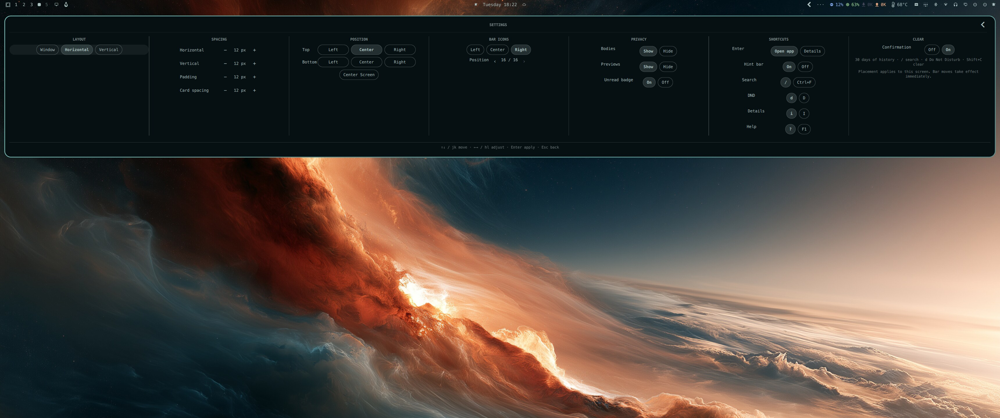

# Omarchy Notification Center


A notification center for [Omarchy](https://omarchy.org) Quattro. It is a bar
widget and a keyboard-first history surface: scrollable cards, a detail card
per notification, search, dismiss one or all, an unread badge, Do Not Disturb,
and a settings view for layout, spacing, monitors, and shortcuts.

The center does **not** own the notification server. It reads the history of
the stock `omarchy.notifications` service, or of the optional
[Notification Engine](https://github.com/ApachaiZ/omarchy-notification-engine)
when you install it and want this project to display and manage notifications
itself.


All captures use synthetic notification content on an empty desktop.

## Features

- **Virtualized list** — only the rows inside the viewport are instantiated,
  so a full 1000-entry archive starts as fast as a handful of notifications.
  Search spans the whole archive.
- **History** — reads the active service's history. With the stock
  `omarchy.notifications` service it shows whatever that service retains; with
  the optional **Notification Engine** it keeps 30 days (up to 1000 entries).
  **Capture toasts** can be switched Off with the engine to stop new history;
  live toasts still display and remain actionable.
- **Search** — `/` (or `Ctrl+F`) and the header icon filter app names, titles,
  and bodies.
- **Date groups** — the list separates Today, Yesterday, weekdays, and older
  dates.
- **Archived images** — with the engine, notification images are copied once
  into the private archive, pruned with the history, and purged when previews
  are disabled. With the stock service, its own image copies are read.
- **Card list** — app icon, app name, relative time, title, and a body preview.
  The keyboard cursor is the only card with the theme's accent border.
- **Detail view** — full summary, full body, and the attached image when the
  notification carries one. Decoded images are bounded to the card size.
- **Dismiss one or all** — hover a card for its remove button, right-click a
  card, or use the header's clear button.
- **Unread badge** — counts notifications received since the center was last
  opened.
- **Do Not Disturb** — right-click the bell or use the header button; silenced
  notifications still land in the list.
- **Three layouts** — floating window, horizontal band, or vertical band.
  Each side margin, the padding, and the gap between cards are configurable.
- **Open the sender** — `Enter` (default) or clicking a card focuses the
  application that sent the notification; `i` or the info button opens the
  detail card. `Enter` can be switched to open details instead.
- **Help and hints** — `g`/`G` jump to the first/last notification, `?` shows
  the shortcut help, and a discreet hint bar lists the active commands. The
  bar can be hidden.
- **Privacy** — hide notification bodies, disable and purge image previews, or
  hide the unread badge. The center and engine drop remote image URLs; with the
  stock service, its own toasts keep the stock service's behavior.
- **Keyboard control** — arrows or `h`/`j`/`k`/`l`, `Enter`, `Del`/`x`, `/`
  search, `d` Do Not Disturb, `Shift+C` clear, `g`/`G`, `?`, `Esc`, and
  the Settings key (default `s`). The search, DND, details, settings, and
  help keys are configurable in Settings.
- **Keyboard-driven settings** — arrows or `hjkl` move between settings,
  left/right adjust the focused value, `Enter` applies.
- **Placement settings** — choose the window position (top/bottom ×
  left/center/right) with a fine edge margin, and move the bar icon between the
  left, center, and right sections with an exact index.
- **Chosen monitors** — pin the center and its toasts to one or several of the
  detected outputs (up to four). The choice is explicit and independent of the
  focused monitor; selecting both shows both windows on both screens.
- **Matching toasts (engine)** — when the notification engine is installed,
  toasts use the center's position; a centered vertical placement is clamped
  to the top so a toast never sits in the middle of the screen. With the stock
  service, toasts use the stock service's own placement.
- **Theme-aware** — colors, radius, and fonts come from the active Omarchy
  theme.

| List | Search |
| --- | --- |
|  |  |

| Detail | Settings |
| --- | --- |
|  |  |

| Horizontal band | Vertical band |
| --- | --- |
|  |  |

| Settings (window) | Settings (horizontal band) |
| --- | --- |
|  |  |

| Shortcut help | |
| --- | --- |
|  | |

| Bar bell | Silence |
| --- | --- |
|  |  |

## Notification engine (optional)

The center works **without** an engine: enable the stock
`omarchy.notifications` service and the center reads its live toasts and
history. To let this project display and manage notifications itself, install
the optional [Notification Engine](https://github.com/ApachaiZ/omarchy-notification-engine):

```bash
omarchy plugin add https://github.com/ApachaiZ/omarchy-notification-engine --enable --yes
```

**Warning:** the engine replaces `omarchy.notifications` for notification
display and management. Only one process can own the notification bus; the
shell's clone guard disables `omarchy.notifications` when the engine is
enabled. The center stays installed, but the stock service stops handling
notifications.

You can also install it from **Settings → Privacy → Notification engine →
Install**. To return to the stock service:

```bash
omarchy plugin remove apach.notification-engine
omarchy plugin enable omarchy.notifications
```

The center continues to work either way.

**Capture toasts** only applies when the engine is active:

- **On (default)** — received toasts are displayed and kept in the engine's
  30-day history.
- **Off** — live toasts still display and remain actionable, but nothing new
  is added to history. Existing history is untouched.
- With the stock service, the setting is ignored; the stock service always
  keeps its own history.

The engine is a separate plugin and repository. The center and the engine are
two separate plugins; each needs its own marketplace listing if published.

## Settings

The gear button in the panel header or the configured Settings key (`s` by
default; `Shift+P` is selectable) opens the settings view:

- **Layout** — `Window` (floating card), `Horizontal` band, or `Vertical`
  band.
- **Margins** — `Horizontal` (left and right together) and `Vertical`
  (top and bottom together), 0–64 px in 4 px steps. The bar's own thickness is
  added on its side.
- **Padding / Card spacing** — one global inner padding (4–32 px, all sides)
  and the gap between notification cards (2–24 px).
- **Centered sections** — Layout, Spacing, Position, Bar icons, Privacy,
  Shortcuts, and Clear keep their title above the content. In window/vertical
  modes they stack with horizontal dividers; in a horizontal band they run
  left to right as equal columns separated by vertical rules.
- **Privacy** — show/hide bodies, show/hide previews (with the engine, hiding
  purges archived image copies), show/hide the unread badge, and **Capture
  toasts** On/Off. Capture only applies to the engine; with the stock service
  it is ignored. The **Notification engine** section offers the optional
  engine installation with its replacement warning.
- **Shortcuts** — choose what `Enter` opens (app or details), show/hide the
  hint bar, and pick the Search (`/` or `Ctrl+F`), DND (`d`/`D`), Details
  (`i`/`I`), Settings (`s`/`Shift+P`), and Help (`?`/`F1`) keys.
- **Position** — `Top`/`Bottom` and `Left`/`Center`/`Right` anchor, plus a
  `Center Screen` button that centers the panel in the middle of the display.
  A vertical band always hangs from the top: its Bottom row and the
  `Center Screen` button are disabled, and only the left/center/right anchor
  applies.
- **Screens** — choose one or more detected monitors (up to four) that host
  both the center and its toasts. The list comes from the outputs present at
  runtime, not from hardcoded names or the focused monitor. Left/right moves
  the screen cursor, `Enter` toggles it, and the buttons also toggle directly.
  If a chosen output disappears, both surfaces fall back to the same remaining
  output.
- **Bar icon** — `Left`, `Center`, or `Right` section, plus a position stepper
  for the exact index inside that section. Moves go through
  `omarchy bar move`, so the bar updates immediately.
- **Clear confirmation** — `Shift+C` asks for a second press by default; turn
  the confirmation off to clear on the first press.
- **History note** — the archive keeps 30 days (up to 1000 entries).

Settings are stored in
`${XDG_STATE_HOME:-$HOME/.local/state}/omarchy/notifications-center.json`
alongside the last-seen timestamp.

## Keyboard

| Key | Action |
| --- | --- |
| `/` or `Ctrl+F` | Search app, title, or body |
| `↑` / `↓` or `k` / `j` | Move the cursor / scroll |
| `Enter` or `Space` | Open the sender app (configurable) / go back |
| `i` | Open the detail card for the selection |
| `g` / `G` | First / last notification |
| `Del` or `x` | Remove the selected notification |
| `d` | Toggle Do Not Disturb |
| `Shift+C` | Clear all (press twice unless confirmation is off) |
| `?` | Show shortcut help |
| `s` or `Shift+P` (configured) | Open settings |
| `Esc` | Leave search, detail, or settings, then close |
| `↑` / `↓` / `j` / `k` (settings) | Move between settings rows |
| `←` / `→` / `h` / `l` (settings) | Adjust the selected value |
| `Enter` / `Space` (settings) | Apply the selected action |

Clicking a card focuses the sending application; right-click dismisses it.
Use the info button on the card (or `Enter` on the keyboard) for its detail.
Scrollbars appear in a reserved gutter when the list or band overflows.

## Install

```bash
omarchy plugin add https://github.com/ApachaiZ/omarchy-notification-center.git --enable
```

The widget lands next to the weather widget by default. To place it explicitly:

```bash
omarchy bar put apach.notifications --section center
```

Bind a shortcut in `~/.config/hypr/bindings.lua` (the plugin does not modify
your configuration), then reload Hyprland:

```lua
o.bind("SUPER + N", "Notification center", "omarchy-shell shell toggle apach.notifications")
```

```bash
hyprctl reload
```

`SUPER + N` opens and closes the center; clicking the bell does the same.

## Requirements

- Omarchy Quattro with the Omarchy shell (`omarchy-shell`), a notification
  service (stock `omarchy.notifications` or the optional engine), and the
  `qs.Ui` component kit.
- Hyprland (layer-shell panel).
- No external runtime dependencies or background daemons beyond the selected
  notification service.

## Data and permissions

The center reads the active notification service's state: live toasts and
history under `~/.local/state/omarchy/notifications`, the engine archive at
`~/.local/state/omarchy/notifications-archive.json`, and DND from
`notifications.json`. It calls `omarchy-shell notifications …` to dismiss,
clear, and toggle Do Not Disturb. It never owns the notification bus.

With the engine, the archive is kept under
`~/.local/state/omarchy/notifications-archive.json` (30 days or 1000 entries)
and image copies under `notifications/images/`. With the stock service, the
center reads the stock service's own history and image copies. Clearing the
center clears the active service's history.

Notification images are copied only from local files by the engine; remote
URLs and other URI schemes are dropped, so displaying a notification never
fetches the network. App names, titles and bodies are capped while parsing
(256/512/8192 characters), so a malformed or oversized history file cannot
exhaust memory. Bodies render as StyledText with `` tags stripped
before Qt parses them. The private archive, history, and image directories are
created with mode `0700`. With **Capture toasts** off, the engine does not
write new notifications to the archive; they stay in memory for their live
toast only. With the stock service the setting is ignored.

## Development

The center's pure helpers in `Model.js` (history parsing, settings, image
sanitizing) are covered by Node's built-in test runner:

```bash
node --test tests/*.test.mjs
```

The optional engine has its own tests in the
[engine repository](https://github.com/ApachaiZ/omarchy-notification-engine).

## Remove

```bash
omarchy plugin remove apach.notifications
```

Notification history is left untouched. Remove the `SUPER + N` line from
`bindings.lua` and run `hyprctl reload`. Removing the center does not remove
the optional engine; remove it separately and re-enable the stock service if
needed:

```bash
omarchy plugin remove apach.notification-engine
omarchy plugin enable omarchy.notifications
```

## License

GPL-3.0. See [LICENSE](LICENSE).
