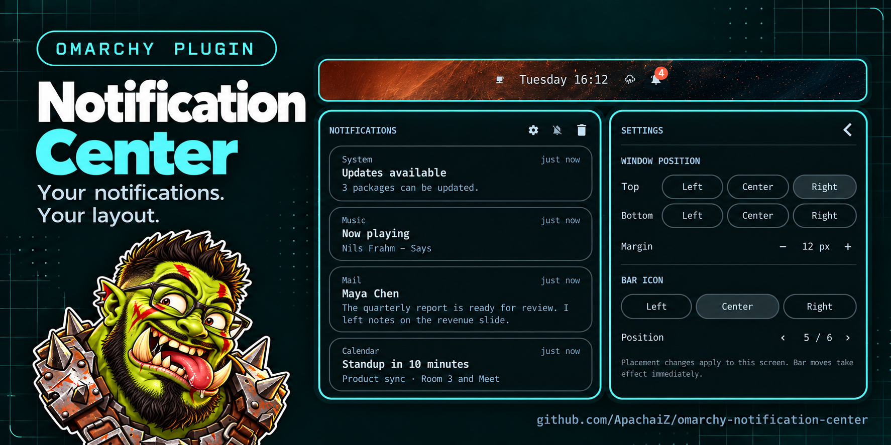
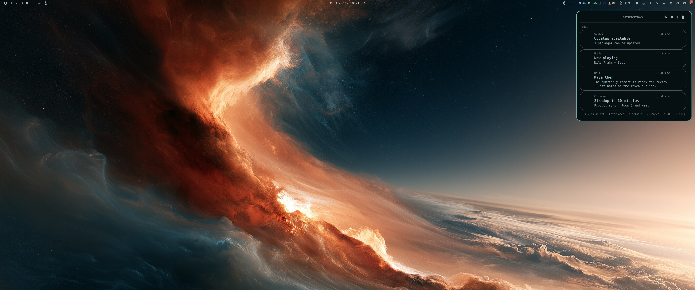
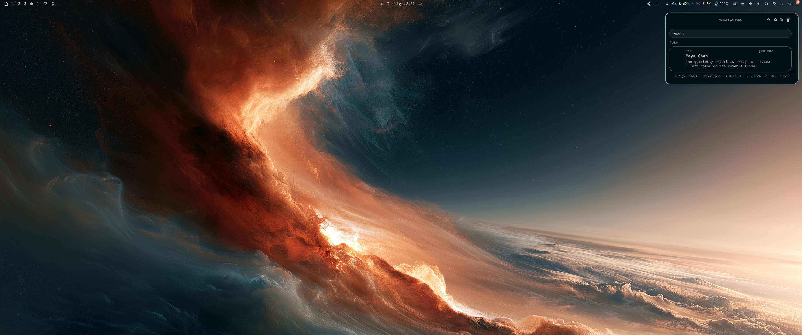
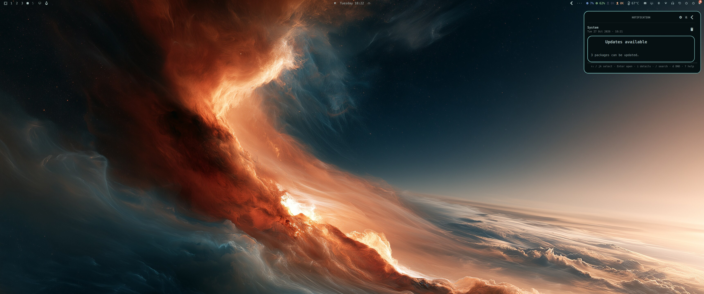
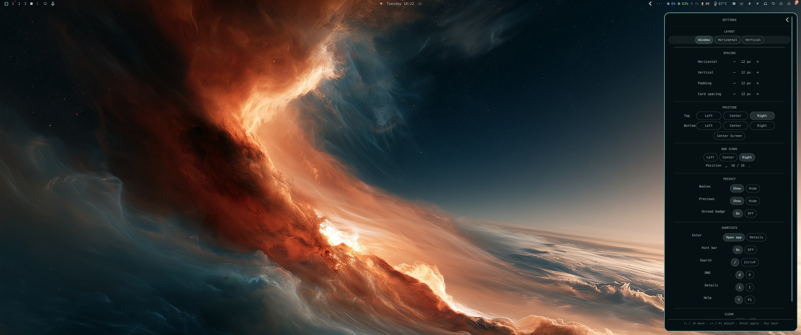
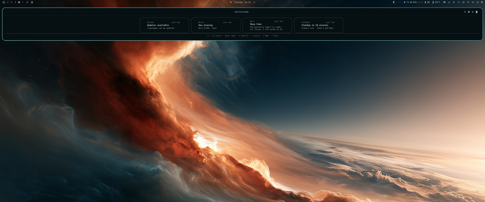
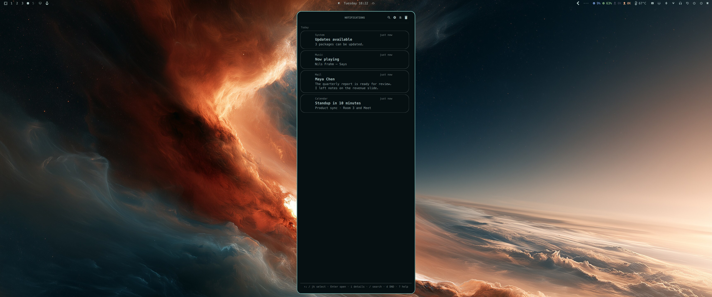
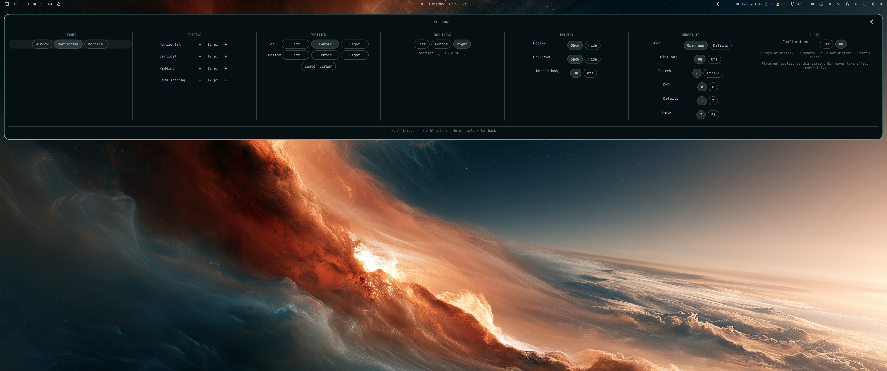
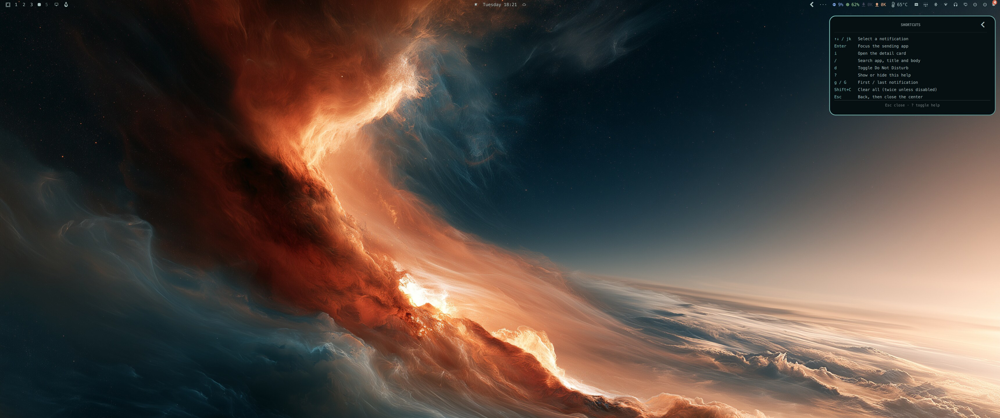

# Omarchy Notification Center



A GNOME-style notification center for [Omarchy](https://omarchy.org) Quattro.
The shell already shows toast notifications; this plugin adds somewhere to look
back at them: a scrollable list of cards, a detail card per notification,
30 days of private history, search, dismiss one or all, an unread badge,
Do Not Disturb, and a settings view for layout, spacing, and shortcuts.



## Features

- **30 days of history** — notifications currently on screen plus a private
  archive (30 days, up to 1000 entries) that outlives the shell service's
  short rolling history.
- **Search** — `/` (or `Ctrl+F`) and the header icon filter app names, titles,
  and bodies.
- **Date groups** — the list separates Today, Yesterday, weekdays, and older
  dates.
- **Archived images** — notification images are copied into the private
  archive (unless previews are disabled) and pruned with the history.
- **Card list** — app icon, app name, relative time, title, and a body preview.
  The keyboard cursor is the only card with the theme's accent border.
- **Detail view** — full summary, full body, and the attached image when the
  notification carries one. Decoded images are bounded to the card size.
- **Dismiss one or all** — hover a card for its remove button, right-click a
  card, or use the header's clear button.
- **Unread badge** — counts notifications received since the center was last
  opened.
- **Do Not Disturb** — right-click the bell or use the header button; silenced
  notifications still land in the list.
- **Three layouts** — floating window, horizontal band, or vertical band.
  Each side margin, the padding, and the gap between cards are configurable.
- **Open the sender** — `Enter` (default) or clicking a card focuses the
  application that sent the notification; `i` or the info button opens the
  detail card. `Enter` can be switched to open details instead.
- **Help and hints** — `g`/`G` jump to the first/last notification, `?` shows
  the shortcut help, and a discreet hint bar lists the active commands. The
  bar can be hidden.
- **Privacy** — hide notification bodies, disable and purge image previews, or
  hide the unread badge.
- **Keyboard control** — arrows or `h`/`j`/`k`/`l`, `Enter`, `Del`/`x`, `/`
  search, `d` Do Not Disturb, `Shift+C` clear, `g`/`G`, `?`, `Esc`, and
  `s`/`Shift+P` settings. The search, DND, details, and help keys are
  configurable in Settings.
- **Keyboard-driven settings** — arrows or `hjkl` move between settings,
  left/right adjust the focused value, `Enter` applies.
- **Placement settings** — choose the window position (top/bottom ×
  left/center/right) with a fine edge margin, and move the bar icon between the
  left, center, and right sections with an exact index.
- **Theme-aware and multi-monitor** — colors, radius, and fonts come from the
  active Omarchy theme; the panel opens on the focused monitor.

| List | Search |
| --- | --- |
|  |  |

| Detail | Settings |
| --- | --- |
|  |  |

| Horizontal band | Vertical band |
| --- | --- |
|  |  |

| Settings (window) | Settings (horizontal band) |
| --- | --- |
|  |  |

| Shortcut help | |
| --- | --- |
|  | |

| Bar bell | Silence |
| --- | --- |
|  |  |

## Settings

The gear button in the panel header, `s`, or `Shift+P` opens the settings view:

- **Layout** — `Window` (floating card), `Horizontal` band, or `Vertical`
  band.
- **Margins** — `Horizontal` (left and right together) and `Vertical`
  (top and bottom together), 0–64 px in 4 px steps. The bar's own thickness is
  added on its side.
- **Padding / Card spacing** — one global inner padding (4–32 px, all sides)
  and the gap between notification cards (2–24 px).
- **Centered sections** — Layout, Spacing, Position, Bar icons, Privacy,
  Shortcuts, and Clear keep their title above the content. In window/vertical
  modes they stack with horizontal dividers; in a horizontal band they run
  left to right as equal columns separated by vertical rules.
- **Privacy** — show/hide bodies, show/hide previews (hiding purges the
  archive image copies), and show/hide the unread badge.
- **Shortcuts** — choose what `Enter` opens (app or details), show/hide the
  hint bar, and pick the Search (`/` or `Ctrl+F`), DND (`d`/`D`), Details
  (`i`/`I`), and Help (`?`/`F1`) keys.
- **Position** — `Top`/`Bottom` and `Left`/`Center`/`Right` anchor, plus a
  `Center Screen` button that centers the panel in the middle of the display.
  A vertical band always hangs from the top: its Bottom row and the
  `Center Screen` button are disabled, and only the left/center/right anchor
  applies.
- **Bar icon** — `Left`, `Center`, or `Right` section, plus a position stepper
  for the exact index inside that section. Moves go through
  `omarchy bar move`, so the bar updates immediately.
- **Clear confirmation** — `Shift+C` asks for a second press by default; turn
  the confirmation off to clear on the first press.
- **History note** — the archive keeps 30 days (up to 1000 entries).

Settings are stored in
`${XDG_STATE_HOME:-$HOME/.local/state}/omarchy/notifications-center.json`
alongside the last-seen timestamp.

## Keyboard

| Key | Action |
| --- | --- |
| `/` or `Ctrl+F` | Search app, title, or body |
| `↑` / `↓` or `k` / `j` | Move the cursor / scroll |
| `Enter` or `Space` | Open the sender app (configurable) / go back |
| `i` | Open the detail card for the selection |
| `g` / `G` | First / last notification |
| `Del` or `x` | Remove the selected notification |
| `d` | Toggle Do Not Disturb |
| `Shift+C` | Clear all (press twice unless confirmation is off) |
| `?` | Show shortcut help |
| `s` / `Shift+P` | Open settings |
| `Esc` | Leave search, detail, or settings, then close |
| `↑` / `↓` / `j` / `k` (settings) | Move between settings rows |
| `←` / `→` / `h` / `l` (settings) | Adjust the selected value |
| `Enter` / `Space` (settings) | Apply the selected action |

Clicking a card focuses the sending application; right-click dismisses it.
Use the info button on the card (or `Enter` on the keyboard) for its detail.
Scrollbars appear in a reserved gutter when the list or band overflows.

## Install

```bash
omarchy plugin add https://github.com/ApachaiZ/omarchy-notification-center.git --enable
```

The widget lands next to the weather widget by default. To place it explicitly:

```bash
omarchy bar put apach.notifications --section center
```

Bind a shortcut in `~/.config/hypr/bindings.lua` (the plugin does not modify
your configuration), then reload Hyprland:

```lua
o.bind("SUPER + N", "Notification center", "omarchy-shell shell toggle apach.notifications")
```

```bash
hyprctl reload
```

`SUPER + N` opens and closes the center; clicking the bell does the same.

## Requirements

- Omarchy Quattro with the Omarchy shell (`omarchy-shell`), its notification
  service, and the `qs.Ui` component kit.
- Hyprland (layer-shell panel).
- No external runtime dependencies, services, or background daemons.

## Data and permissions

The plugin reads the notification service's state directory
(`~/.local/state/omarchy/notifications`) and calls the shell's notification IPC
to dismiss, clear, and toggle Do Not Disturb. It performs no network access and
runs inside the existing `omarchy-shell` process.

The private archive lives at
`${XDG_STATE_HOME:-$HOME/.local/state}/omarchy/notifications-center/`; its
entries are pruned to 30 days or 1000, and image copies live under `images/`. Clearing the center empties both the
archive and the shell's history. Images referenced by archived notifications
stay in the shell's own image directory, so they may disappear once the service
rotates that storage.

## Remove

```bash
omarchy plugin remove apach.notifications
```

Notification history is left untouched. Remove the `SUPER + N` line from
`bindings.lua` and run `hyprctl reload`.

## License

GPL-3.0. See [LICENSE](LICENSE).
